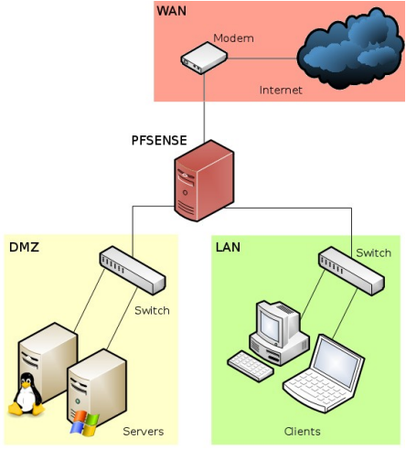

# TP PfSense

Loïc Mouthuy

BTS SIO

<aside>

# C’est quoi PfSense ?

</aside>

 PfSense est un système d'exploitation open-source, principalement utilisé comme pare-feu et routeur.
Il s’administre assez facilement via une interface web et permet de gérer la sécurité et le réseau d’une entreprise :

- Pare-feu et routage : Filtrage du trafic, gestion des VLANs
- Services réseau : Serveur/relais DHCP, serveur DNS, NAT
- Sécurité et accès distant : VPN, détection d’intrusions

<aside>

# Topologie

</aside>

<aside>
📎

# Chapitre 1 : DMZ

</aside>

# Contexte

</aside>

La société Vikor désire installer un serveur Web au sein de son architecture réseau ,ce serveur doit être accessible depuis le LAN de l’entreprise ainsi que de « l’extérieur » ,à savoir internet.
Afin de sécuriser au maximum son réseau ,le choix de PfSense a été fait en raison de sa flexibilité et du nombre de fonctionnalités disponibles.

<aside>

# Installation du PfSense

</aside>

Tout d’abord il faut se munir d’une VM dotée de 3 interfaces réseau : LAN, DMZ, WAN.

Ici la net0 est bridgé sur ma carte réseau physique et les deux autres ne le sont pas, net0 sera donc la carte utiliser pour l’interface WAN du PfSense.

Pour installer un PfSense sur une machine virtuelle, il faut se munir d’un iso PfSense NetGate puis il faut suivre les instructions d’installation. Nous allons d’abord nous demander quelle carte réseau doit être utiliser pour quelle interface :

Nous avons donc le WAN sur vtnet0, le LAN sur vtnet1 et la DMZ sur vtnet2.

Puis nous finalisons l’installations en suivant les étapes jusqu’à arriver sur ce menu :

<aside>

# Connection du serveur web à la DMZ

</aside>

Pour connecter le serveur web (LAMP) à l’interface de la DMZ il faut tout d’abord avoir un serveur LAMP, nous allons utiliser celui crée précédemment dans ce tp : [TP Serveurs](https://app.notion.com/p/TP-Serveurs-3d6c44fec5b480598baac5d7a76f0539?pvs=21) 

Puis nous allons le mettre sur le même bridge réseau que l’interface DMZ du PfSense, ici ce sera donc la vmbr2 :

Puis attribuer une ip statique au serveur web avec la même adresse réseau que la DMZ :

Pour l’instant nous ne pouvons pas ping les deux machines entre elles mais c’est tout à fait normal car l’interface DMZ n’est pas encore configurer sur le PfSense.

<aside>

# Configuration PfSense

</aside>

<aside>

## Client d’administration

</aside>

Pour configurer le PfSense, il me faut une VM cliente sur le LAN qui pourra accéder à l’interface web du PfSense. Pour cela, comme pour le serveur LAMP, il faut attribuer le même bridge à la VM cliente et à l’interface LAN (vmbr1) :

puis attribuer une adresse ip à la VM cliente avec la même adresse réseau que l’interface LAN du PfSense :

<aside>

## Configuration de l’interface DMZ

</aside>

Maintenant que notre client est connecter sur l’interface LAN du PfSense, nous pouvons accéder à l’interface web de configuration du pfsense en tapant l’adresse ip de l’interface LAN du PfSense sur un navigateur web :

Depuis l’interface de configuration, nous allons commencer par crée l’interface DMZ  qui n’est pas crée automatiquement sur le PfSense, pour cela il suffit de se rendre dans l’onglets interface et de crée l’interface DMZ comme ceci, en cochant “enable interface” pour activer l’interface:

Sans oublier de configurer l’adresse ip de l’interface avec la même adresse réseau que nous avons attribuer à notre serveur web :

<aside>

# Configuration des règles

</aside>

Nous voulons accéder à notre serveur web depuis l’interface LAN et WAN du PfSense, pour cela il va falloir établir des règles qui vont permettre au machines des différentes interfaces d’accéder au serveur LAMP qui est située dans la DMZ.

<aside>

## Règles du WAN

</aside>

Pour que le WAN ai accès au serveur LAMP, nous allons établir une redirection de port sur l’interface WAN. Le but est que lorsque un utilisateur tape l’adresse IP de l’interface WAN sur une machine connecter au WAN, il tombe directement sur la page web du serveur web et donc que l’adresse IP de l’interface WAN redirige vers celle du serveur LAMP.

Pour cela  nous ajoutons la règles sur l’interface WAN puis nous lui attribuons le protocol TCP :

Et enfin nous configurons la source sur “Any” qui permet à toute utilisateur étant connecter sur le WAN d’y avoir accès. Et nous configuration la destination sur l’adresse IP de notre serveur WEB avec comme port d’écoute le port 80 (HTTP) :

Cette règle permet donc d’autoriser l’interface WAN vers le serveur web, il faut maintenant configurer la redirection automatique dans le NAT qui va rediriger tout trafic entrant sur le port 80 soit rediriger vers l’adresse IP du serveur web :

ET voila nous pouvons voir que lorsque l’on entre l’adresse IP de l’interface WAN du PfSense, nous arrivons directement sur la page web du serveur LAMP :

<aside>

## Règles du LAN

</aside>

Pour que l’interface LAN ai accès au serveur web de la DMZ il suffit d’ajouter une règles qui autorise les machines du LAN à communiquer vers l’adresse IP du serveur web :

Avec cette simple règles on peut accéder directement au serveur web depuis le LAN :

<aside>
📎

# Chapitre 2 : Addon

</aside>

# Contexte

</aside>

Vous venez d’installer PfSense pour la société LSL avec accès au serveur web situé dans la DMZ .Le DSI de l’entreprise souhaite maintenant pouvoir monitorer via un navigateur le maximum d’informations concernant le réseau LAN.

<aside>

# Monitoring : ntopng

</aside>

Concernant le monitoring, nous allons utiliser l’outil ntopng qui est directement intégrer à PfSense. Pour cela il suffit d’installer le service à sa dernière version :

Puis de l’activer et configurer le mot de passe d’administration :

Une fois cela fait il suffit de taper l’adresse ip de l’interface LAN suivie de “:3000“ pour accéder à l’interface de supervision :

<aside>

# Mise en place du bureau à distance

</aside>

## Contexte

</aside>

Le DSI souhaite maintenant installer un serveur Windows dans la DMZ accessible en bureau à distance via le protocole RDP sur le port par défaut, et ce depuis internet . Par mesure de sécurité vous utiliserez un port différent de votre choix associé à l’adresse WAN du PFSense avec redirection du flux vers l’adresse du serveur Windows associé au port par défaut .

<aside>

## Configuration de la machine Windows server

</aside>

Il faut donc connecter notre machine Windows serveur à l’interface DMZ. Pour cela il faut utiliser le même bridge que celui de l’interface DMZ (vmbr2 ici) et lui configurer une adresse ip avec la même adresse réseau que l’interface et l’adresse ip de l’interface DMZ en tant que passerelle :

Puis il faut simplement activer le bureau à distance dans les paramètre de la machine Windows server :

<aside>

## Règles sur le PfSense

</aside>

Maintenant que le bureau à distance est activer sur la machine Windows server et qu’elle est connecter à l’interface DMZ, il faut juste ajouter une redirection de port sur le PfSense pour pouvoir personnaliser le port de connexion du bureau à distance :

Ici on utilise le port 6767 qui sera rediriger vers le port 3389 qui est le port par défaut RDP.
